# Accommodation Center
[Live demo](https://dimie.dev)

A full-stack platform for managing residential buildings. Tenants are
assigned to apartments, maintenance issues are tracked from report to
resolution, and a community forum lets residents coordinate with each
other. Built with Django, Next.js, PostgreSQL, and Celery.

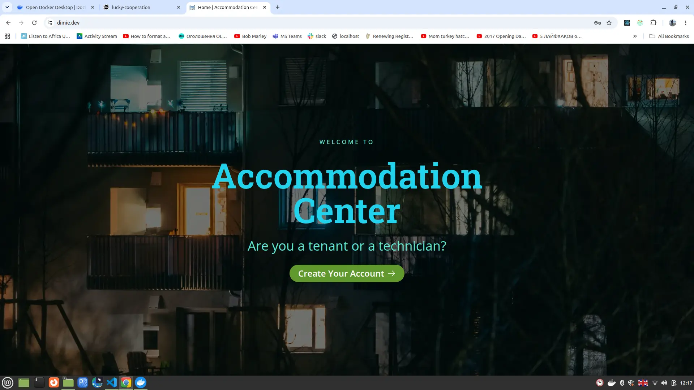

## Features

**For tenants**
- Register, activate via email, and sign in with a password or Google OAuth
- View and manage their apartment assignment
- Upload a profile avatar (stored in Cloudinary)
- Report maintenance issues to their building
- Create and interact with community forum posts
- Bookmark and vote on posts
- Rate technicians after a service

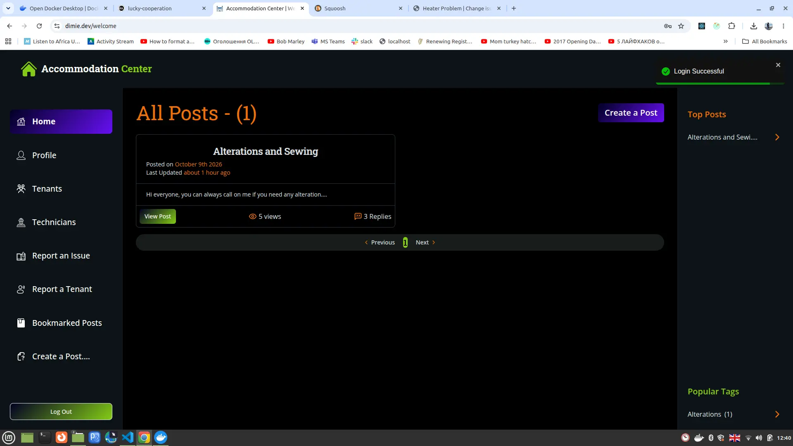
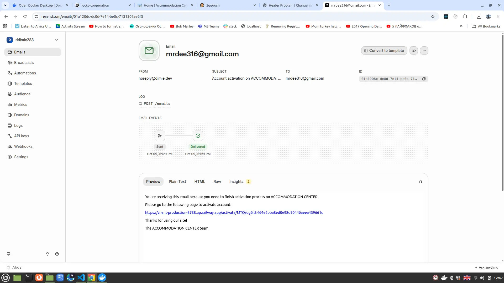

**For technicians**
- Sign in and see issues assigned to them
- Update the status of assigned issues
- Browse the community forum

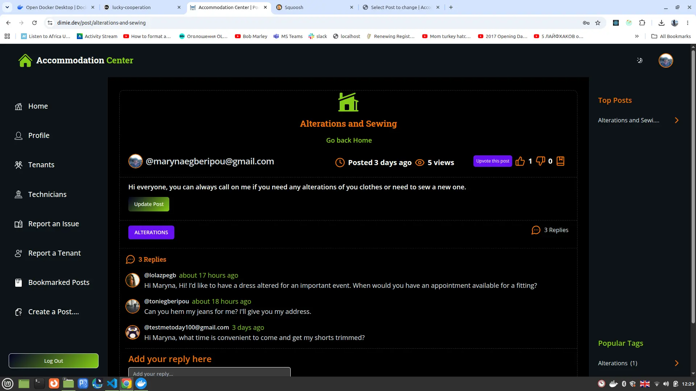
**For administrators**
- Full Django admin with filters, search, and bulk actions
- Manage apartments, tenants, issues, and technicians
- Assign issues to technicians (with automatic email notification)
- Monitor background tasks via Flower
- Review and act on user reports
- Moderate users (banned after five reports, with automatic account deactivation)

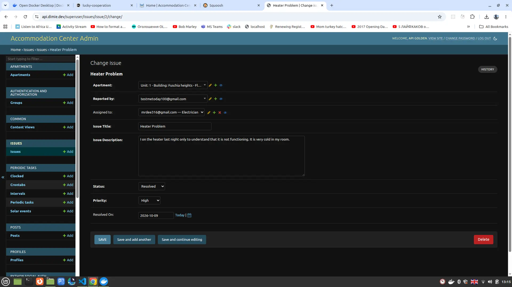


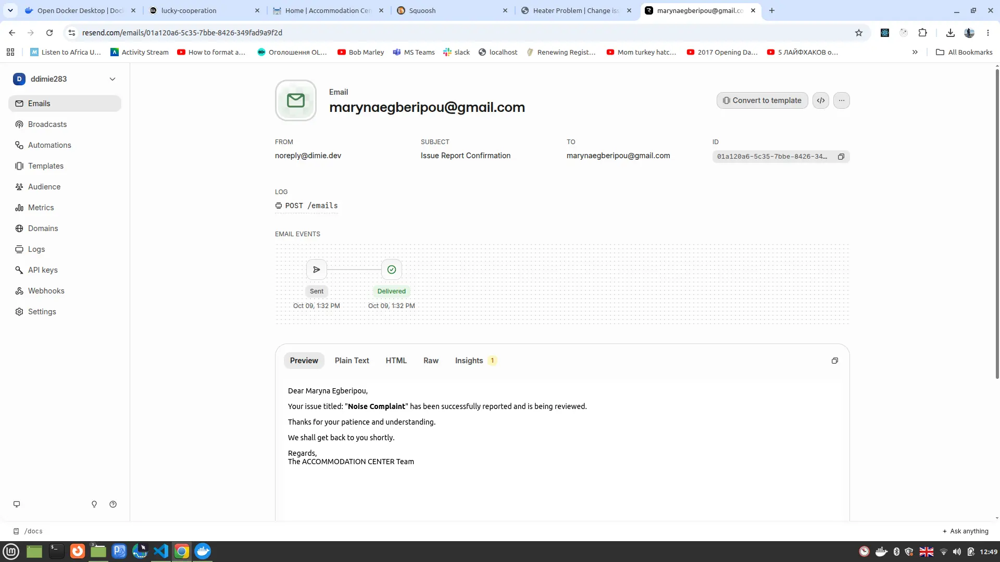
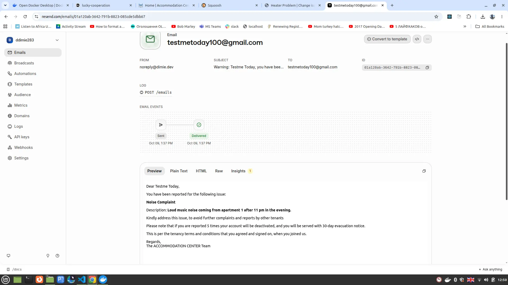

## Stack

| Layer | Technologies |
|---|---|
| Backend | Django 4.2, Django REST Framework, PostgreSQL |
| Frontend | Next.js, TypeScript, Tailwind CSS, shadcn/ui |
| Authentication | JWT in HttpOnly cookies, Google OAuth |
| Background tasks | Celery, Celerybeat, Redis(Flower for local monitoring) |
| Email | Django templates, CeleryEmailBackend, Mailpit (local), django-anymail + Resend (production) |
| Infrastructure | Docker + nginx (local), Railway (production) |
| API documentation | DRF Spectacular (Swagger, ReDoc) |
| Testing | pytest, pytest-django (333 tests) |

## Quick start

**Prerequisites:** Docker >= 20.10, Docker Compose >= 2.0

```bash
git clone https://github.com/Dee68/accomm_mngt.git
cd accomm_mngt
```

Create the local environment file:

```bash
cp .envs/.env.local.example .envs/.env.local
```

Then build and start the containers:

```bash
make build
make up
```

Once the containers are healthy, the application is available at:

| Service | URL |
|---|---|
| Frontend | http://localhost:8080 |
| API documentation (Swagger) | http://localhost:8080/api/v1/docs/ |
| API documentation (ReDoc) | http://localhost:8080/api/v1/redoc/ |
| Django admin | http://localhost:8080/superuser/ |
| Mailpit (captured emails) | http://localhost:8025 |
| Flower (task monitoring) | http://localhost:5555 |

## Running tests


```bash
docker compose -f local.yml exec api pytest core_apps/ -v
```
The full suite is 333 tests covering models, views, serializers,
permissions, forms, admin configuration, signals, background tasks,
email delivery, and URL routing. The suite runs in approximately 25
seconds.

## Architecture

### Local development

Nine Docker services behind an nginx reverse proxy: `api`, `client`,
`postgres`, `redis`, `celeryworker`, `celerybeat`, `flower`, `mailpit`,
`nginx`.

### Production (Railway)

Three deployable services (`api`, `client`, `celery_workers`) plus managed
Postgres and Redis. No nginx, no Flower, no Mailpit — Railway
terminates TLS and routes by hostname, and Mailpit's role is taken over
by Resend, which receives outbound email through `django-anymail`.

Emails are sent through Celery using `CeleryEmailBackend`, so they don't
block the request cycle. In development, Mailpit intercepts every
outbound message. In production, the SMTP backend points at a
transactional email provider through environment variables.

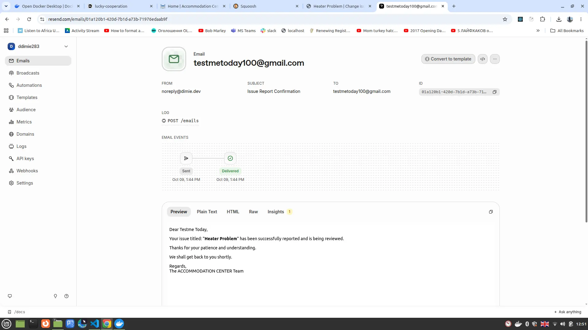
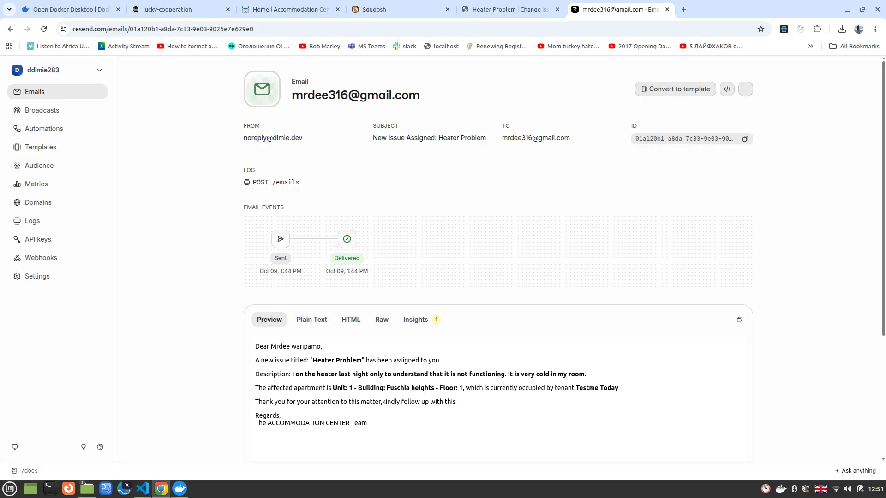
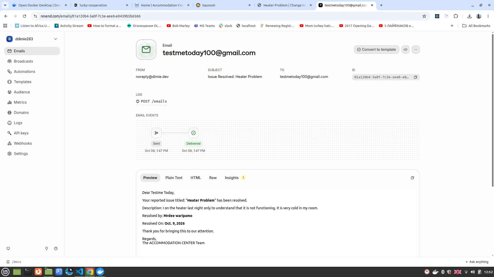

## Environment variables

The backend reads configuration from `.envs/.env.local`. Required
variables:

```env
DJANGO_SECRET_KEY=your-secret-key
DJANGO_ADMIN_URL=superuser/
POSTGRES_USER=apigolden
POSTGRES_PASSWORD=your-db-password
POSTGRES_DB=apartment
POSTGRES_HOST=postgres
POSTGRES_PORT=5432
CELERY_BROKER_URL=redis://redis:6379/0
CELERY_RESULT_BACKEND=redis://redis:6379/0
CLOUDINARY_CLOUD_NAME=your-cloud-name
CLOUDINARY_API_KEY=your-api-key
CLOUDINARY_API_SECRET=your-api-secret
GOOGLE_CLIENT_ID=your-google-client-id
GOOGLE_CLIENT_SECRET=your-google-client-secret
EMAIL_HOST=mailpit
EMAIL_PORT=1025
DEFAULT_FROM_EMAIL=noreply@example.com
DOMAIN=localhost:8080
COOKIE_SECURE=False
REDIRECT_URIS=http://localhost:8080
```

The above are local development values. Production additionally requires:

```env
RESEND_API_KEY=your-resend-api-key
ANYMAIL_RESEND_API_KEY=${RESEND_API_KEY}
CORS_ALLOWED_ORIGINS=https://dimie.dev
CSRF_TRUSTED_ORIGINS=https://dimie.dev,https://api.dimie.dev
SESSION_COOKIE_SAMESITE=None
SESSION_COOKIE_SECURE=True
COOKIE_SAMESITE=None
COOKIE_SECURE=True
```

## Project structure

```
accomm_mngt/
├── api/                       # Django backend
│   ├── config/                # Settings (base, local, production)
│   ├── core_apps/
│   │   ├── apartments/        # Apartment management
│   │   ├── common/            # Shared abstractions
│   │   ├── issues/            # Maintenance tickets
│   │   ├── posts/             # Community forum
│   │   ├── profiles/          # User profiles
│   │   ├── ratings/           # User ratings
│   │   ├── reports/           # Moderation reports
│   │   └── users/             # Custom user model
│   ├── requirements/
    ├── manage.py  
│   ├── local.yml              # Docker Compose for development
│   └── Makefile
└── client/                    # Next.js frontend
    ├── app/                   # App router pages
    ├── components/            # Shared UI components
    ├── lib/redux/             # Redux Toolkit + RTK Query
    └── hooks/                 # Custom React hooks
```

## Deployment

The application is deployed on Railway:

- **api** — Django, gunicorn, connected to managed Postgres and Redis
- **client** — Next.js, deployed from the same repository
- **celery_workers** — Celery worker (see `workers.sh`)

External services connected in production:

- **Cloudinary** — avatar storage, keeping the container stateless
- **Resend via django-anymail** — transactional email delivery
- **Google OAuth** — sign-in with Google

Environment variables are set per-service in Railway's dashboard. The
production `DJANGO_SETTINGS_MODULE` is `config.settings.production`.


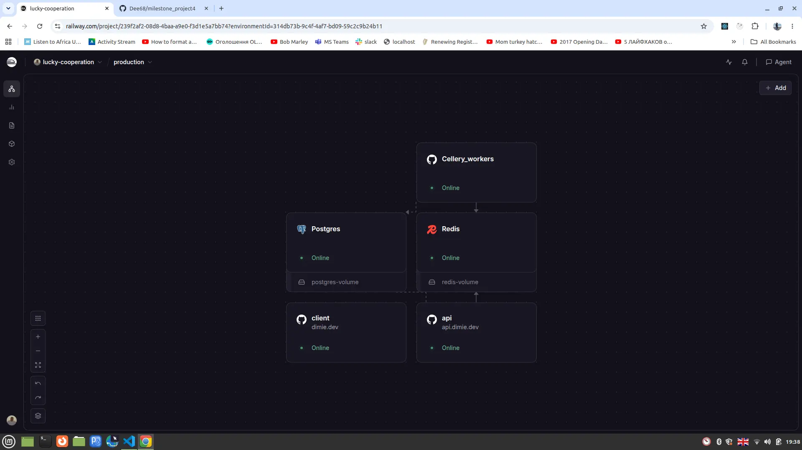


## License

This project is licensed for educational and portfolio purposes. You
are welcome to read, clone, and learn from the code. Commercial use
and republishing as your own work are not permitted.